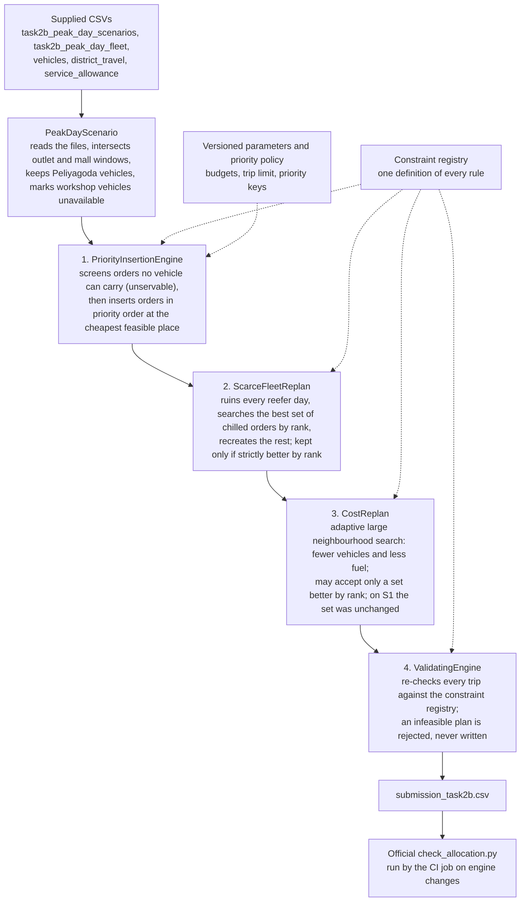

<!--
Note for the team, before submitting: the booklet asks for a written policy of
about one page or less. Sections 1 to 6 are the policy; the appendices are
supporting material. If the judges want only the policy, submit sections 1 to 6
as the policy and include the appendices separately (for example as
TASK-2B-METHOD.md). 
-->

# Task 2B: peak-day allocation policy (Scenario S1, Peliyagoda)

No trained model is used. The allocation is produced by Waypoint's planning engine:
- every hard rule is checked in its constraint registry;
- orders are taken in a fixed, versioned priority order (version 2, below);
- a second pass re-plans the refrigerated vehicles as a whole.

Every number below comes from the engine's output (`submission_task2b.csv`, written by `PeakDayAllocationTest`) and from the supplied data files. The official `check_allocation.py` reports **"FEASIBILITY: PASSED - every rule satisfied"**, and the relevant CI job checks the generated allocation on every pull request that touches the engine.

## 1. Demand against available capacity

Of the 38 vehicles in the scenario, **10 are in the workshop**. That includes **5 of the 9 refrigerated vehicles**: 4 reefer trucks and 1 reefer van.

| | Demand | Available to carry it |
| --- | --- | --- |
| Fresh chilled | 26 orders, **181.6 m³**, 32,780 kg, in 7 districts | **4 reefers** (3 trucks, 1 van): 86.2 m³ and 17,000 kg per round; 172.4 m³ and 34,000 kg nominal two-trip capacity if every reefer ran two full trips (district separation, access and time keep usable capacity lower) |
| Fresh ambient | 49 orders, 133.0 m³ | 22 dry trucks, 2 dry vans, plus spare reefer room |
| Style | 5 orders, 77.2 m³ | dry trucks (480-minute budget) |
| Tech | 5 orders, 18.1 m³ | dry trucks (480-minute budget) |

## 2. What limited service: refrigerated trips before 08:00

Chilled goods ride only in reefers, and all chilled windows close by 08:00 (9 at 07:30, 4 at 07:45, 13 at 08:00; each earlier deadline is also checked), so the Fresh budget of **270 minutes per vehicle** (03:30 to 08:00) applies. Each trip carries one brand to one district. That leaves **8 reefer trips** (4 vehicles × 2) for **7 chilled districts**. Two far districts cannot share a reefer: a Puttalam trip (188 minutes) and a Kurunegala trip (176 minutes) together take 364 of the 270 minutes.

What the engine did with the 8 trips, all within the budget (trip minutes = outbound + travel between stops + handling, no return). For example, VEH006's Gampaha trip carries three Fresh rear-dock orders: 37 + 9 × (3 − 1) + 15 + 15 + 15 = **100 minutes**.

| Reefer | Trip 1 | Trip 2 | Fresh minutes used |
| --- | --- | --- | --- |
| VEH003 truck (26.4 m³, 5,510 kg) | Kurunegala, 2 orders, 13.0 m³ (176 min) | Colombo, 3 orders, 25.8 m³ (86 min) | 262 / 270 |
| VEH006 truck (33.4 m³, 6,840 kg) | Galle, 2 orders, 20.3 m³ (143 min) | Gampaha, 3 orders, 28.2 m³ (100 min) | 243 / 270 |
| VEH007 truck (19.4 m³, 3,610 kg) | Puttalam, 1 order, 8.7 m³ (188 min) | Gampaha, 2 orders, 13.6 m³ (77 min) | 265 / 270 |
| VEH036 van (7.0 m³, 1,040 kg) | Kalutara, 1 order, 5.1 m³ (80 min) | Colombo, 2 orders, 4.2 m³ (64 min) | 144 / 270 |

**118.8 m³ of chilled goods are carried: 16 of 26 chilled orders, 65.4% of chilled volume** (87.1% of all orders are served). Refrigerated trip availability and Fresh time budgets limit overall service; volume, weight and van access further restrict which orders fit. Every reefer runs both its trips, and the three trucks are within 27 minutes of the budget. Dry trucks, vans and the Style/Tech budget are not limiting: every Fresh ambient, Style and Tech order fits, except one (below).

## 3. Result

- **74 of 85 orders served.** 10 deferred and 1 unservable.
- 13 vehicles and 26 trips used.
- **All 10 outlets deferred yesterday are served today**, so no outlet is skipped twice in a row.
- **Every store whose chilled order waits was served yesterday** (`days_since_last_served` = 1 for all 10), and each still receives its ambient order today.
- In the CSV, the oversized S1-078 is written as `deferred` (the template allows only served or deferred), so the file reads **74 served and 11 deferred**.
- **Our extra rules did not change which orders are served.** The engine also checks each outlet's own window, one temperature class per trip and the weekly fuel quota, which the booklet's checker does not. Run with those switched off, the same engine and policy serve the same 74 orders and 118.8 m³ chilled (Appendix D); only the vehicle and trip assignment can differ.

## 4. Which deferrals were unavoidable, and which were a choice

**Unavoidable:**
- **S1-078** (Style, Kurunegala) is **40.66 m³**, larger than the largest vehicle (38 m³). It cannot be served by any vehicle on any day without splitting, which the rules forbid. It is marked unservable. A revised order of two parts under 38 m³ is a necessary first step, not a guarantee: each part must still fit weight, time and a district trip.
- **Some chilled deferral.** Demand is 181.629 m³ against a nominal ceiling of 172.4 m³ even if every reefer ran two full trips, so at least 9.229 m³ must wait whatever the plan. Under our priority policy, this allocation defers **62.807 m³**; we do not claim this is the minimum possible.

**A choice: which chilled orders wait.** With only 8 reefer trips, the engine decides which districts and stops get them, by this fixed priority order (version 2, Appendix C):
1. deferred yesterday (`deferred_yesterday`);
2. Fresh;
3. chilled;
4. longest since last served (`days_since_last_served`);
5. strict or mall window;
6. the brand's ordering cadence;
7. earliest window close;
8. then longest distance and largest volume as tie-breaks.

The order is lexicographic: the first line that tells two orders apart decides. Every rule the vehicles must keep comes before it.

| Deferred (insertion barriers under the selected allocation) | Why it could not be added | What it costs |
| --- | --- | --- |
| Colombo: S1-003 (van-only), S1-007, S1-016, S1-021 (21.6 m³) | The Colombo truck trip (VEH003) is at 25.8 of 26.4 m³ and 262 of 270 Fresh minutes; another stop takes it to 285 or more. S1-003 needs a van, and adding it to the reefer van's Colombo load (2 orders, 4.17 m³, 766.7 kg) takes the van to 1,095.7 of 1,040 kg. S1-007 (2.925 m³, 567.7 kg) fits the van on its own, but added to that load exceeds both caps (7.095 of 7.0 m³, 1,334.4 of 1,040 kg). S1-016 and S1-021 exceed the van's caps outright | Chilled replenishment delayed a day for four stores, each served yesterday and receiving its ambient order today |
| Gampaha: S1-033 (6.2 m³) | Both Gampaha trips are full by volume: VEH006 would reach 34.4 of 33.4 m³, VEH007 19.9 of 19.4 m³ (and 289 of 270 Fresh minutes) | One store, served yesterday |
| Kalutara: S1-048, S1-051 (11.0 m³) | The only Kalutara trip is the reefer van's (5.1 m³, 951 kg); either order takes it past 7.0 m³ and 1,040 kg | Two stores, served yesterday |
| Matara: S1-064, S1-067 (12.0 m³) | No reefer trip was left once higher-ranked chilled orders were placed; a Matara trip (137 minutes each way) needs one of the 8 trips to itself | Two stores, served yesterday |
| Kurunegala: S1-071 (12.0 m³) | It fits VEH003's Kurunegala trip by volume and weight, but the extra stop takes VEH003 to 296 of its 270 Fresh minutes | One store, served yesterday |

Tomorrow every one of these enters the highest priority category (deferred yesterday), alongside other previously deferred orders, subject to feasibility. The second pass on the reefers kept the 74 orders the first pass served and carried 6.0 m³ more chilled goods; it only drops an order when a higher-ranked one takes its place.

## 5. The signals the brief asks for

| Signal | How it is used |
| --- | --- |
| `deferred_yesterday` | Ranked first: 10 of 10 served |
| `days_since_last_served` | Ranked fourth, right after Fresh and chilled: among chilled Fresh orders, the store that has waited longer is served first. On S1 every store whose chilled order waits was served yesterday. This placement is version 2 of the policy: replayed over 80 stressed days at both depots it serves as many orders as version 1 or more on all but one day, and on S1 it serves 74 orders and 118.8 m³ chilled instead of 73 and 109.2 (Appendix D) |
| Chilled and perishable goods before the festival | Fresh and chilled are ranked above all other brands, and the reefers are re-planned as a whole to improve service under the priority ranking |
| 8 AM Fresh deadline | The 270-minute Fresh budget per vehicle, and earliest window close as a key |

## 6. What would serve more

- **Get reefers out of the workshop**, or hire reefers for the festival week. Each extra reefer adds up to two permitted trips before 08:00, not necessarily two feasible ones; the gain needs a rerun of the engine with that fleet.
- **Ask OUT070 to send S1-078 again as two orders** under 38 m³ each, for a later day; this allocation cannot split it.

The engine's cost stage then reduced estimated fuel (trip distance over each vehicle's km per litre, return leg included) from 735.1 to **627.9 litres**, vehicles from 17 to **13** and trips from 32 to **26**, while retaining the same served orders. It is a bounded search (2,000 iterations), so this is an improvement, not a proven minimum.

---

The policy itself is sections 1 to 6 above. The appendices below record how the allocation was produced, the rules and assumptions it rests on, the experiments behind it, and how to reproduce it.

## Appendix A. How the allocation is produced, with no trained model

The booklet says Task 2B "does not require a trained model", so none is used. The allocation is the output of a deterministic optimisation pipeline written in Java: the same planning engine that plans deliveries in the Waypoint product (`backend/.../planning`). It reads the supplied CSVs, applies every rule, chooses which orders to serve and on which vehicle and trip, and writes `submission_task2b.csv`. The deliverable is that CSV and this policy. The "model" is the engine's code and its versioned parameters, so the same inputs always give the same file.



The same flow as plain text, for viewers that do not draw the diagram above:

```text
  Supplied CSVs (scenario orders, fleet status, vehicles, district travel, service allowance)
        |
        v
  PeakDayScenario ........ reads the files, outlet and mall windows intersected,
        |                  Peliyagoda vehicles only, workshop vehicles unavailable
        v
  1. PriorityInsertionEngine ... screens orders no vehicle can carry (unservable),
        |                        then places orders in priority order, cheapest feasible place
        v
  2. ScarceFleetReplan ......... re-plans all 4 reefers together; kept only if
        |                        strictly better by rank   (74 served; +6.0 m3 chilled)
        v
  3. CostReplan ................ fewer vehicles and litres; on S1 the served set was unchanged
        |                                         (17 -> 13 vehicles, 735.1 -> 627.9 L)
        v
  4. ValidatingEngine .......... re-checks every trip against every rule;
        |                        an infeasible plan is rejected, never written
        v
  submission_task2b.csv --> official check_allocation.py (CI): FEASIBILITY: PASSED

  Constraint registry (one definition of each rule) ...... read by stages 1 to 4
  Versioned parameters and priority policy .............. read by stage 1
```

| Stage | Code | What it does |
| --- | --- | --- |
| Read | `planning/infrastructure/PeakDayScenario.java` | Loads the scenario as a planning problem. Each order id is derived from `order_ref`, so reruns are identical |
| 1. Insert | `PriorityInsertionEngine`, `CheapestInsertion` | Screens unservable orders, sorts the rest by the priority policy, puts each at the cheapest feasible vehicle and trip. An order with no feasible place is deferred with the rule that blocked its closest candidate |
| 2. Re-plan reefers | `ImprovingEngine`, `ScarceFleetReplan` | The first pass never revisits a reefer trip, so a reefer can spend its pre-dawn budget on one small far load. This pass plans all four reefers together: lists each reefer's feasible one- or two-trip days, then searches for the best chilled set admitting orders highest rank first. Deterministic, with a fixed search budget |
| 3. Cost | `CostImprovingEngine`, `CostReplan` | Removes and reinserts orders (at random from a seeded stream, a whole vehicle, part of a district, the emptiest trip), preferring vehicles already out and fewer added litres. A plan is better only if it serves a better set by rank, then uses fewer vehicles, then fewer litres |
| 4. Validate | `ValidatingEngine`, `ConstraintRegistry` | Checks every trip and order against every rule before the plan leaves the engine |
| Write | `PeakDayScenario.submissionCsv` | One row per order in the template's order. An unservable order is written as `deferred`, since the template allows only served or deferred |

## Appendix B. Rules applied

Every rule is defined once in the constraint registry and read by every stage, so the four stages cannot disagree about what is feasible.

| Booklet rule | Registry id | How it is checked |
| --- | --- | --- |
| 1 Brand and district | R-PLN-01 | Every order on a trip has the trip's brand and district |
| 2 Refrigeration | R-PLN-02 | A chilled order rides only on a reefer |
| 3 Vehicle access | R-PLN-03 | A `van_only` outlet gets a van |
| 4 Home depot | R-PLN-04 | Only Peliyagoda vehicles are loaded at all |
| 5 Whole orders | R-PLN-05 | One order, one vehicle, one trip; never split |
| 6 Capacity | R-PLN-06 | Trip volume and weight within the caps, compared with the validator's own tolerance of 1e-6 |
| 7 Trips and time | R-PLN-07, R-PLN-09, R-PLN-10 | At most 2 trips per vehicle; Fresh trips within 270 minutes in total, Style and Tech within 480, counted separately; trip minutes = outbound + inter-stop + handling, no return journey |
| Workshop vehicles | (scenario) | Vehicles with status `in_workshop` are unavailable |

The engine also applies rules of the Waypoint product that are stricter than the validator. Switching them off does not change the S1 result (Appendix D), but they are part of the method:

| Rule | Id | Effect |
| --- | --- | --- |
| Oversized order | R-PLN-22 | An order larger than every vehicle is unservable, not deferred again and again |
| Delivery window, mall window | R-PLN-13, R-PLN-29, R-PLN-30 | Arrival inside the outlet's window, intersected with the mall's; a window shorter than the handling time is unservable |
| One temperature class per trip | R-PLN-31 | A reefer runs a chilled trip or an ambient trip, not both on one trip |
| Weekly fuel quota | R-PLN-16 | Trip distance consumes the vehicle's quota |
| A recorded reason for every deferral | R-PLN-19 | Each deferred order names the rule that blocked it |
| Improving never trades priority | R-PLN-32, R-PLN-38 | Stages 2 and 3 can never defer a higher ranked order to serve a lower one |

## Appendix C. Assumptions and parameters

| Assumption | Value | Why |
| --- | --- | --- |
| Fresh window and budget | 03:30 to 08:00, 270 minutes per vehicle | Booklet |
| Style and Tech budget | 480 minutes per vehicle, combined, separate from Fresh | Booklet |
| Trips per vehicle | 2 | Booklet |
| Trip time | Outbound once, inter-stop × (orders minus 1), handling per stop; no return | Booklet's three steps, exactly |
| Capacity tolerance | 1e-6 | The same as the official validator, so a plan we call feasible is feasible to the judge |
| Fuel | Every vehicle starts the week unused | The scenario gives no fuel history |
| Service date | Monday 2026-10-05 (bookkeeping only; S1's stated conditions, festival a week away, no payday, no monsoon, are used as given) | The scenario gives none; it only sets the fuel week and the brands' ordering cadence |
| Ordering cadence | Fresh every day, Style weekly, Tech treated as daily (our proxy: the booklet says Tech orders as needed) | Used as one priority key: an order of a brand ordered less often costs more to miss |
| Strict window | shorter than 120 minutes | Used as one priority key |
| Priority order | Version 2: deferred yesterday, Fresh, chilled, longest since last served, strict window, cadence, earliest close, then longest distance and largest volume | Keep stores from missing twice, protect perishable stock before the festival, then serve the store that has waited longer. Version 1 had longest since last served as the last tie-break; version 2 was adopted after the replay in appendix D, for the product and this submission alike (`planning.policy_versions`, effective 2026-10-09) |
| Search budgets | Stage 2: fixed node budget; stage 3: 2,000 iterations; whole engine: 10 seconds as a safety stop | Fixed seed and fixed node and iteration budgets are part of the engine version; reruns are byte-identical when the search completes within the safety stop (tested) |

## Appendix D. Experiments

All measured on S1 by `PeakDayAllocationTest` and `PeakDayExperimentsTest`, and repeatable.

| Stage | Served | Deferred | Unservable | Vehicles | Trips | Fuel |
| --- | --- | --- | --- | --- | --- | --- |
| 1. Priority insertion only | 74 | 10 | 1 | not measured | not measured | not measured |
| 1 + 2. Reefers re-planned as a whole | **74** | **10** | 1 | 17 | 32 | 735.1 L |
| 1 + 2 + 3. Cost stage | **74**, the same orders | **10** | 1 | **13** | **26** | **627.9 L** |

- **Stage 2** kept the same 74 orders and carried **6.0 m³ more chilled goods**. Its search covered all 26 chilled orders (539,237 search nodes) and finished within its budget.
- **Stage 3** kept exactly the same served orders and used 4 fewer vehicles, 6 fewer trips and 107.2 L less fuel (14.6%).
- **Why the 11 not served were not served,** by the rule that blocked each: capacity (R-PLN-06) 6, which includes the unservable S1-078; trips per vehicle (R-PLN-07) 4; the Fresh 270-minute budget (R-PLN-09) 1. These describe failed candidate placements in this allocation; they do not prove that each deferral is unavoidable in every allocation.
- **Controlled comparisons** (`PeakDayExperimentsTest`): the same engine and inputs, one thing changed at a time. Every variant's CSV passes the official checker.

  | Variant | Served | Chilled served | Chilled m³ | Vehicles | Trips |
  | --- | --- | --- | --- | --- | --- |
  | Submitted (all rules, priority version 2) | 74 | 16 of 26 | 118.8 | 13 | 26 |
  | Without outlet windows | 74 | 16 | 118.8 | 13 | 25 |
  | Without one temperature class per trip | 74 | 16 | 118.8 | 13 | 26 |
  | Booklet rules only (no windows, temperature separation or fuel quota) | 74 | 16 | 118.8 | 13 | 25 |
  | Priority version 1 (longest since last served as the last tie-break) | 73 | 15 | 109.2 | 13 | 25 |
  | Longest since last served second, before Fresh | 74 | 16 | 118.8 | 13 | 26 |

  Our extra rules do not change which orders are served on S1; without outlet windows the cost stage finds one trip fewer. The priority order does matter: version 2 serves one more order and 9.6 m³ more chilled goods than version 1.
- **Replay over 80 stressed days** (`PriorityReplayTest`), to choose the order on more than one day. The 40 busiest dispatch days of each depot in the training data keep their real orders, windows and history (`deferred_yesterday` and days since last served, from the dispatch record); each day's fleet loses a seeded 55% of reefers and 20% of dry vehicles to the workshop, as on S1. 69 of the 80 days defer orders under version 1.

  | Priority order | Orders served | Chilled m³ served | Deferred after waiting 2+ days |
  | --- | --- | --- | --- |
  | Version 1 | 4,974 | 3,049.9 | 78 |
  | **Version 2 (adopted)** | **4,975** | **3,054.0** | **77** |
  | Longest since last served second, before Fresh | 4,944 | 3,034.9 | 71 |

  Version 2 differs from version 1 on 3 of the 80 days (2 more orders served, 1 fewer) and never by more than one order; with S1's gain it was adopted for the product and this submission alike. Putting waiting time before Fresh lowers repeat waiting but serves fewer orders on 10 days, because weekly Style orders then outrank Fresh chilled goods, so it was not adopted. The training data stays on the team's machine; the test runs only when pointed at it.
- **Robustness checks**, each an automated test:
  - the same inputs give a byte-identical CSV;
  - all 10 outlets deferred yesterday are served;
  - with the time budget exhausted, the engine still returns a decision for all 85 orders and marks the plan partial;
  - a deliberately infeasible engine (every order on one truck) is rejected by stage 4 before anything is written.

## Appendix E. Reproducing it

From the repository root, with Java 17 and Maven for the engine, and Python 3 with pandas for the checker. No database is needed. On Windows, `tools/check_allocation/data` is a symbolic link to `data/`: clone with `git config core.symlinks true` (and Developer Mode on), or copy `data/` into `tools/check_allocation/data`. The comparisons in appendix D run with `mvn test -Dtest=PeakDayExperimentsTest` and write their CSVs to `backend/target/task2b/experiments/`.

```bash
cd backend && mvn test -Dtest=PeakDayAllocationTest      # writes backend/target/task2b/submission_task2b.csv
cd .. && python tools/check_allocation/check_allocation.py backend/target/task2b/submission_task2b.csv
# FEASIBILITY: PASSED - every rule satisfied.
```

`tools/check_allocation/check_allocation.py` is the organisers' checker, vendored unmodified. CI runs both commands on every pull request, so the allocation in the submission is the one the current code produces.
