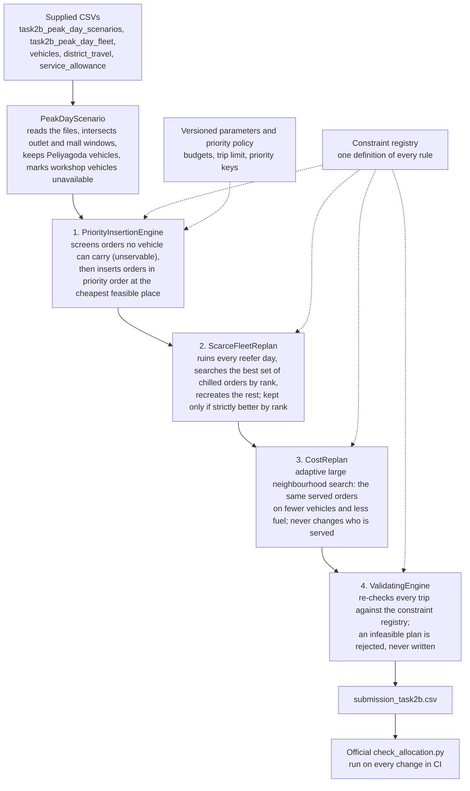

# Task 2B: peak-day allocation policy (Scenario S1, Peliyagoda)

No trained model is used. The allocation is produced by Waypoint's planning engine:
- every hard rule is checked in its constraint registry;
- orders are taken in a fixed priority order;
- a second pass re-plans the refrigerated vehicles as a whole.

Every number below comes from the engine's output (`submission_task2b.csv`, written by `PeakDayAllocationTest`) and from the supplied data files. The official `check_allocation.py` reports **"FEASIBILITY: PASSED - every rule satisfied"**, and runs on every change in CI.

## 1. Demand against available capacity

Of the 38 vehicles in the scenario, **10 are in the workshop**. That includes **5 of the 9 refrigerated vehicles**: 4 reefer trucks and 1 reefer van.

| | Demand | Available to carry it |
| --- | --- | --- |
| Fresh chilled | 26 orders, **181.6 m³**, 32,780 kg, in 7 districts | **4 reefers** (3 trucks, 1 van): 86.2 m³ per round, 172.4 m³ if every reefer ran two full trips |
| Fresh ambient | 49 orders, 133.0 m³ | 22 dry trucks, 2 dry vans, plus spare reefer room |
| Style | 5 orders, 77.2 m³ | dry trucks (480-minute budget) |
| Tech | 5 orders, 18.1 m³ | dry trucks (480-minute budget) |

## 2. What limited service: refrigerated trips before 08:00

Chilled goods ride only in reefers, and every chilled window closes at 08:00, so the Fresh budget of **270 minutes per vehicle** (03:30 to 08:00) applies. Each trip carries one brand to one district. That leaves **8 reefer trips** (4 vehicles × 2) for **7 chilled districts**. The farthest district is 173 minutes from the depot one way (Puttalam), so a vehicle cannot fit two distant trips in 270 minutes.

What the engine did with the 8 trips, all within the budget (trip minutes = outbound + stops + handling, no return):

| Reefer | Trip 1 | Trip 2 | Fresh minutes used |
| --- | --- | --- | --- |
| VEH003 truck | Puttalam, 8.7 m³ (188 min) | Gampaha, 21.2 m³ (76 min) | 264 / 270 |
| VEH006 truck | Colombo, 30.9 m³ (108 min) | Galle, 20.3 m³ (143 min) | 251 / 270 |
| VEH007 truck | Kurunegala, 13.0 m³ (176 min) | Kalutara, 5.9 m³ (79 min) | 255 / 270 |
| VEH036 van | Colombo, 4.2 m³ (64 min) | Kalutara, 5.1 m³ (80 min) | 144 / 270 |

**109.2 m³ of chilled goods are carried. The binding resource is reefer trips within the 270-minute window, not volume.** Every reefer runs both its trips, and three of the four are within 19 minutes of the budget. Dry trucks, vans and the Style/Tech budget are not limiting: every Fresh ambient, Style and Tech order fits, except one (below).

## 3. Result

- **73 of 85 orders served.** 11 deferred and 1 unservable.
- 13 vehicles and 25 trips used.
- **All 10 outlets deferred yesterday are served today**, so no outlet is skipped twice in a row.

## 4. Which deferrals were unavoidable, and which were a choice

**Unavoidable:**
- **S1-078** (Style, Kurunegala) is **40.66 m³**, larger than the largest vehicle (38 m³). It cannot be served by any vehicle on any day without splitting, which the rules forbid. It is marked unservable and needs the store to split the order.
- **The amount of chilled goods deferred.** Demand is 181.6 m³ against a hard ceiling of 172.4 m³ even if every reefer ran two full trips. With one district per trip and the 270-minute window, about 72 m³ cannot go today whatever the choice.

**A choice: which chilled orders wait.** With only 8 reefer trips, the engine decides which districts and stops get them, by this fixed priority order:
1. deferred yesterday (`deferred_yesterday`);
2. Fresh;
3. chilled;
4. strict or mall window;
5. the brand's ordering cadence;
6. earliest window close;
7. then distance, volume and longest unserved (`days_since_last_served`) as tie-breaks.

| Deferred | Why that one | What it costs |
| --- | --- | --- |
| Matara, S1-064 and S1-067 (12.0 m³) | 137 minutes each way: a Matara trip would take a reefer's budget that serves more volume nearer | Two stores without chilled stock for a day; last served yesterday, so this is their first miss |
| Gampaha, 4 of 6 (S1-028, S1-031, S1-033, S1-035, 26.9 m³) | The Gampaha trip filled VEH003 to 21.2 of 26.4 m³; the next four do not fit the trip, and no reefer trip is left | Four stores short of chilled goods a week before the festival. They are first in line tomorrow under rule 1 |
| Colombo, S1-003 (van-only), S1-007, S1-012 (16.5 m³) | Colombo's reefer truck is full (30.9 of 33.4 m³). S1-003 needs a van, and the only reefer van would go over its **weight** limit (1,096 of 1,040 kg) though it has room in volume; S1-007 is over the van's volume and weight | Three stores; Colombo has the most chilled outlets (9), so the shortfall is spread |
| Kalutara S1-048, Kurunegala S1-071 (17.1 m³) | S1-048 would take VEH007 to 282 of its 270 Fresh minutes, and is over the reefer van's caps; S1-071 (12.0 m³) does not fit the 6.4 m³ left on the Kurunegala trip | Two stores |

The second pass on the reefers raised served orders from 70 (simple first fit) to 73. It only drops an order when a higher-ranked one takes its place.

## 5. The signals the brief asks for

| Signal | How it is used |
| --- | --- |
| `deferred_yesterday` | Ranked first: 10 of 10 served |
| `days_since_last_served` | Tie-break among equals. Every deferred order was served 1 or 2 days ago, so none goes long without stock |
| Chilled and perishable goods before the festival | Fresh and chilled are ranked above all other brands, and the reefers are re-planned as a whole to carry the most chilled volume |
| 8 AM Fresh deadline | The 270-minute Fresh budget per vehicle, and earliest window close as a key |

## 6. What would serve more

- **Get reefers out of the workshop**, or hire reefers for the festival week. Each extra reefer adds two trips before 08:00; 6 reefers give 12 trips for the 7 chilled districts instead of 8, which addresses the binding constraint directly (the exact gain needs a rerun of the engine with that fleet).
- **Ask OUT070 to split S1-078** into two orders under 38 m³.

After that, the remaining shortfall is time before 08:00, not trucks: the far districts (Puttalam, Matara, Kurunegala) need an early first trip.

The same engine also chose the vehicles and trips at lowest cost: **13 vehicles and 611 litres** of fuel, against 16 vehicles and 725 litres for the first feasible plan. The served set is unchanged.

---

The policy itself is sections 1 to 6 above. The appendices below record how the allocation was produced, the rules and assumptions it rests on, the experiments behind it, and how to reproduce it.

## Appendix A. How the allocation is produced, with no trained model

The booklet says Task 2B "does not require a trained model", so none is used. The allocation is the output of a deterministic optimisation pipeline written in Java: the same planning engine that plans deliveries in the Waypoint product (`backend/.../planning`). It reads the supplied CSVs, applies every rule, chooses which orders to serve and on which vehicle and trip, and writes `submission_task2b.csv`. The deliverable is that CSV and this policy. The "model" is the engine's code and its versioned parameters, so the same inputs always give the same file.



| Stage | Code | What it does |
| --- | --- | --- |
| Read | `planning/infrastructure/PeakDayScenario.java` | Loads the scenario as a planning problem. Each order id is derived from `order_ref`, so reruns are identical |
| 1. Insert | `PriorityInsertionEngine`, `CheapestInsertion` | Screens unservable orders, sorts the rest by the priority policy, puts each at the cheapest feasible vehicle and trip. An order with no feasible place is deferred with the rule that blocked its closest candidate |
| 2. Re-plan reefers | `ImprovingEngine`, `ScarceFleetReplan` | The first pass never revisits a reefer trip, so a reefer can spend its pre-dawn budget on one small far load. This pass plans all four reefers together: lists each reefer's feasible one- or two-trip days, then searches for the best chilled set admitting orders highest rank first. Deterministic, with a fixed search budget |
| 3. Cost | `CostImprovingEngine`, `CostReplan` | Removes and reinserts orders (at random from a seeded stream, a whole vehicle, part of a district, the emptiest trip), preferring vehicles already out and fewer added litres. A plan is better only if it serves a better set by rank, then uses fewer vehicles, then fewer litres |
| 4. Validate | `ValidatingEngine`, `ConstraintRegistry` | Checks every trip and order against every rule before the plan leaves the engine |
| Write | `PeakDayScenario.submissionCsv` | One row per order in the template's order. An unservable order is written as `deferred`, since the template allows only served or deferred |

## Appendix B. Rules applied

Every rule is defined once in the constraint registry and read by every stage, so the four stages cannot disagree about what is feasible.

| Booklet rule | Registry id | How it is checked |
| --- | --- | --- |
| 1 Brand and district | R-PLN-01 | Every order on a trip has the trip's brand and district |
| 2 Refrigeration | R-PLN-02 | A chilled order rides only on a reefer |
| 3 Vehicle access | R-PLN-03 | A `van_only` outlet gets a van |
| 4 Home depot | R-PLN-04 | Only Peliyagoda vehicles are loaded at all |
| 5 Whole orders | R-PLN-05 | One order, one vehicle, one trip; never split |
| 6 Capacity | R-PLN-06 | Trip volume and weight within the caps, compared with the validator's own tolerance of 1e-6 |
| 7 Trips and time | R-PLN-07, R-PLN-09, R-PLN-10 | At most 2 trips per vehicle; Fresh trips within 270 minutes in total, Style and Tech within 480, counted separately; trip minutes = outbound + inter-stop + handling, no return journey |
| Workshop vehicles | (scenario) | Vehicles with status `in_workshop` are unavailable |

The engine also applies rules of the Waypoint product that are stricter than the validator. They did not change the S1 result, but they are part of the method:

| Rule | Id | Effect |
| --- | --- | --- |
| Oversized order | R-PLN-22 | An order larger than every vehicle is unservable, not deferred again and again |
| Delivery window, mall window | R-PLN-13, R-PLN-29, R-PLN-30 | Arrival inside the outlet's window, intersected with the mall's; a window shorter than the handling time is unservable |
| One temperature class per trip | R-PLN-31 | A reefer runs a chilled trip or an ambient trip, not both on one trip |
| Weekly fuel quota | R-PLN-16 | Trip distance consumes the vehicle's quota |
| A recorded reason for every deferral | R-PLN-19 | Each deferred order names the rule that blocked it |
| Improving never trades priority | R-PLN-32, R-PLN-38 | Stages 2 and 3 can never defer a higher ranked order to serve a lower one |

## Appendix C. Assumptions and parameters

| Assumption | Value | Why |
| --- | --- | --- |
| Fresh window and budget | 03:30 to 08:00, 270 minutes per vehicle | Booklet |
| Style and Tech budget | 480 minutes per vehicle, combined, separate from Fresh | Booklet |
| Trips per vehicle | 2 | Booklet |
| Trip time | Outbound once, inter-stop × (orders minus 1), handling per stop; no return | Booklet's three steps, exactly |
| Capacity tolerance | 1e-6 | The same as the official validator, so a plan we call feasible is feasible to the judge |
| Fuel | Every vehicle starts the week unused | The scenario gives no fuel history |
| Service date | Monday 2026-10-05 | The scenario gives none; it only sets the fuel week and the brands' ordering cadence |
| Ordering cadence | Fresh every day, Style weekly, Tech every day | Used as one priority key: an order of a brand ordered less often costs more to miss |
| Strict window | 120 minutes or shorter | Used as one priority key |
| Priority order | Deferred yesterday, Fresh, chilled, strict window, cadence, earliest close, then longest distance, largest volume, longest unserved | Team decision: keep stores from missing twice, then protect perishable stock before the festival |
| Search budgets | Stage 2: fixed node budget; stage 3: 2,000 iterations; whole engine: 10 seconds as a safety stop | Part of the engine version, so the result is repeatable on any machine |

## Appendix D. Experiments

All measured on S1 by `PeakDayAllocationTest`, and repeatable.

| Stage | Served | Deferred | Unservable | Vehicles | Trips | Fuel |
| --- | --- | --- | --- | --- | --- | --- |
| 1. Priority insertion only | 70 | 14 | 1 | | | |
| 1 + 2. Reefers re-planned as a whole | **73** | **11** | 1 | 16 | 32 | 724.8 L |
| 1 + 2 + 3. Cost stage | **73**, the same orders | **11** | 1 | **13** | **25** | **610.6 L** |

- **Stage 2** served 3 more orders and carried **30.4 m³ more chilled goods**. Its search covered all 26 chilled orders (127,623 search nodes) and finished within its budget. Every order it dropped was replaced by a higher ranked one.
- **Stage 3** kept exactly the same served orders and used 3 fewer vehicles, 7 fewer trips and 114.2 L less fuel (16%).
- **Why the 12 not served were not served,** by the rule that blocked each: capacity (R-PLN-06) 6, which includes the unservable S1-078; trips per vehicle (R-PLN-07) 5; the Fresh 270-minute budget (R-PLN-09) 1.
- **Robustness checks**, each an automated test:
  - the same inputs give a byte-identical CSV;
  - all 10 outlets deferred yesterday are served;
  - with the time budget exhausted, the engine still returns a decision for all 85 orders and marks the plan partial;
  - a deliberately infeasible engine (every order on one truck) is rejected by stage 4 before anything is written.

## Appendix E. Reproducing it

From the repository root, with Java 17 and Maven. No database is needed.

```bash
cd backend && mvn test -Dtest=PeakDayAllocationTest      # writes backend/target/task2b/submission_task2b.csv
cd .. && python tools/check_allocation/check_allocation.py backend/target/task2b/submission_task2b.csv
# FEASIBILITY: PASSED - every rule satisfied.
```

`tools/check_allocation/check_allocation.py` is the organisers' checker, vendored unmodified. CI runs both commands on every pull request, so the allocation in the submission is the one the current code produces.
